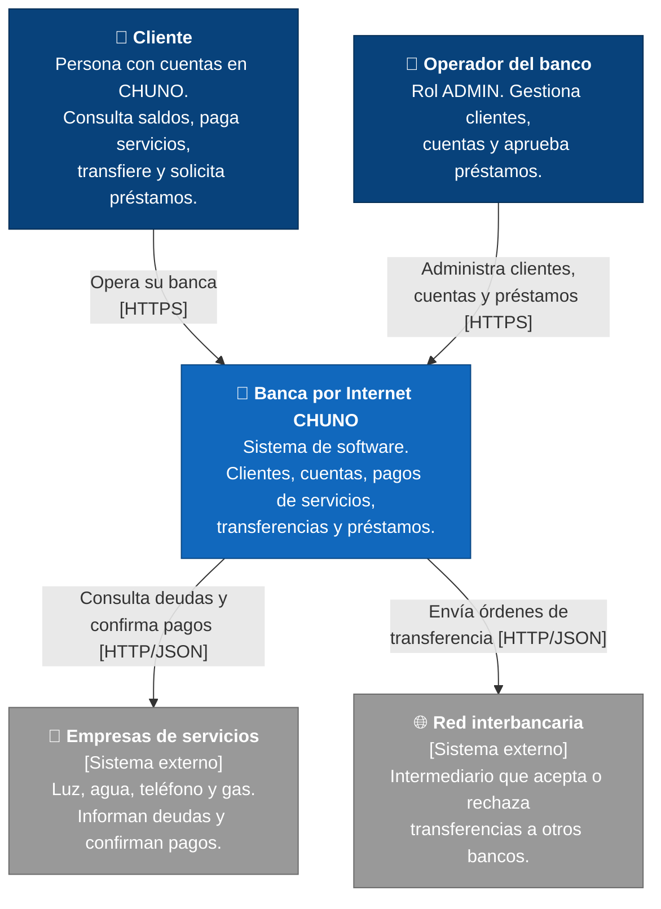
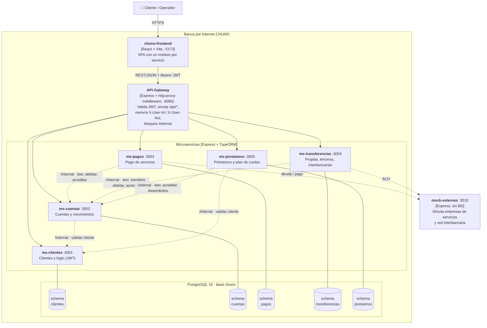
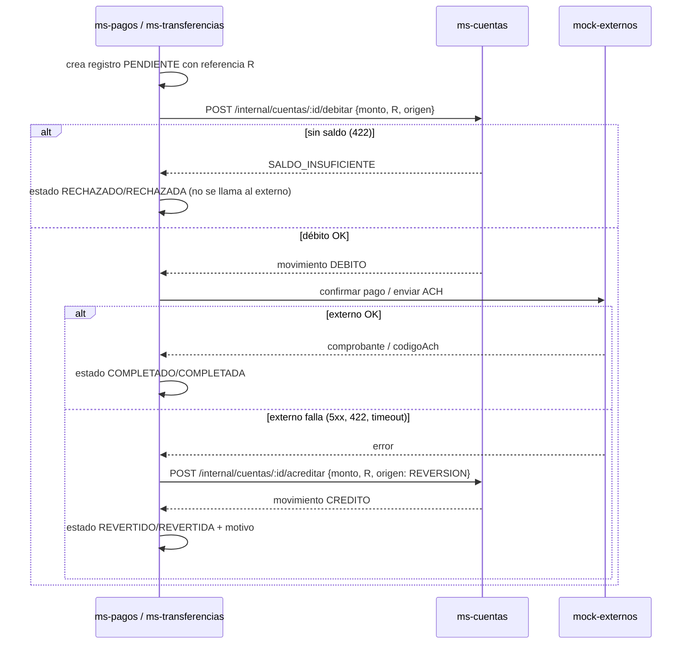

# CHUNO · Arquitectura y contratos entre servicios (HU-01)

Responsable: I1 · Hackathon 24/11/2026

Banca por Internet de la startup CHUNO construida con **microservicios**: Node.js 22 + TypeScript + Express + TypeORM, una sola instancia de PostgreSQL 16 con **un schema por servicio**, React + Vite en el frontend y Docker Compose para levantar todo.

---

## 1. C4 Nivel 1 · Contexto (CA-01)



En el hackathon, las **Empresas de servicios** y la **Red interbancaria** los simula el contenedor `mock-externos`.

---

## 2. C4 Nivel 2 · Contenedores (CA-02)



Líneas punteadas: llamadas internas con la cabecera `X-Internal-Key`. **Nadie** llama a `ms-pagos`, `ms-transferencias` ni `ms-prestamos`.

---

## 3. Servicios, puertos y schemas (T3_HU01)

| Servicio | Puerto | Schema | Rol de BD | Responsable | Depende de |
|---|---|---|---|---|---|
| gateway | **8080** (único publicado) | — | — | I1 | todos los ms-* |
| ms-clientes | 3001 | `clientes` | `user_clientes` | I2 | — |
| ms-cuentas | 3002 | `cuentas` | `user_cuentas` | I3 | ms-clientes |
| ms-pagos | 3003 | `pagos` | `user_pagos` | I4 | ms-cuentas, mock-externos |
| ms-transferencias | 3004 | `transferencias` | `user_transferencias` | I5 | ms-cuentas, mock-externos |
| ms-prestamos | 3005 | `prestamos` | `user_prestamos` | I1 | ms-clientes, ms-cuentas |
| mock-externos | 3010 | sin BD | — | I4 | — |
| db (PostgreSQL 16) | 5432 (5433 en el host) | 5 schemas | `postgres` | I1 | — |
| chuno-frontend | 5173 (`npm run dev`) | — | — | todos | gateway |

Cada rol de BD solo tiene `USAGE` sobre **su** schema (`docker/init-schemas.sql`). Un servicio no puede leer las tablas de otro: los datos ajenos se piden por API.

### Rutas del gateway

| Ruta pública | Servicio destino | Ruta reescrita |
|---|---|---|
| `/api/clientes/*` | ms-clientes | `/clientes/*` |
| `/api/cuentas/*` | ms-cuentas | `/cuentas/*` |
| `/api/pagos/*` | ms-pagos | `/pagos/*` |
| `/api/transferencias/*` | ms-transferencias | `/transferencias/*` |
| `/api/prestamos/*` | ms-prestamos | `/prestamos/*` |

- La única ruta pública es `POST /api/clientes/auth/login`, que llega como `POST /clientes/auth/login`. Todas las demás exigen `Authorization: Bearer <jwt>`.
- El gateway borra cualquier `X-User-Id` o `X-User-Rol` que mande el cliente y los vuelve a poner desde el JWT (`sub` y `rol`).
- Cualquier ruta con un segmento `internal`, aunque venga codificado, responde **404**.

---

## 4. Contratos internos de ms-cuentas (CA-03 · T2_HU01)

Base: `http://ms-cuentas:3002`. Todas las rutas exigen `X-Internal-Key: ${INTERNAL_API_KEY}`. Los tipos están en `packages/shared/src/contracts.ts`.

| Método y ruta | Body | Respuesta 2xx | Quién la usa |
|---|---|---|---|
| `GET /internal/cuentas/:id` | — | `CuentaInterna` | pagos, transferencias, préstamos |
| `GET /internal/cuentas/numero/:numero` | — | `CuentaInterna` | transferencias |
| `POST /internal/cuentas/:id/debitar` | `MovimientoRequest` | el movimiento | pagos, transferencias (interbancaria) |
| `POST /internal/cuentas/:id/acreditar` | `MovimientoRequest` | el movimiento | pagos y transferencias (reversión), préstamos (desembolso) |
| `POST /internal/transferir` | `TransferirRequest` | `{ debito, credito }` | transferencias (propia y tercero) |

```ts
interface CuentaInterna   { id: string; numero: string; clienteId: string; saldo: number; estado: 'ACTIVA' | 'CERRADA' }
interface MovimientoRequest { monto: number; referencia: string /* uuid */; origen: OrigenMovimiento; glosa: string }
interface TransferirRequest { cuentaOrigenId: string; cuentaDestinoId: string; monto: number; referencia: string; glosa: string }
type OrigenMovimiento = 'DEPOSITO' | 'RETIRO' | 'PAGO_SERVICIO' | 'TRANSFERENCIA' | 'DESEMBOLSO' | 'REVERSION'
```

**Reglas del contrato**

1. **Idempotencia:** quien inicia la operación genera la `referencia` (uuid). Si llega un movimiento con la misma `(cuenta_id, tipo, referencia)`, ms-cuentas devuelve el movimiento existente y **no toca el saldo**. Así un reintento nunca cobra ni paga dos veces.
2. **Concurrencia:** cada operación corre en `AppDataSource.transaction()` y bloquea la fila con `pessimistic_write`. `transferir` bloquea las dos cuentas en orden de `id` para evitar deadlocks.
3. **Atomicidad de `transferir`:** el débito y el crédito pasan juntos o no pasa ninguno.

**Errores**

| Caso | HTTP | Cuerpo |
|---|---|---|
| Cuenta inexistente | 404 | `{ code: 'NOT_FOUND' }` |
| Cuenta `CERRADA` | 422 | `{ code: 'BUSINESS_RULE', details: { motivo: 'CUENTA_CERRADA' } }` |
| Saldo insuficiente | 422 | `{ code: 'BUSINESS_RULE', details: { motivo: 'SALDO_INSUFICIENTE' } }` |
| Clave interna inválida | 401 | `{ code: 'UNAUTHORIZED' }` |

### Otros contratos internos

| Servicio | Método y ruta | Respuesta |
|---|---|---|
| ms-clientes | `GET /internal/clientes/:id` | `{ id, nombreCompleto, estado: 'ACTIVO' \| 'BAJA' }` |

---

## 5. Regla de compensación (CA-04)

En la arquitectura no hay transacción distribuida. Cuando una operación **primero debita** en ms-cuentas y **después** depende de un externo, se aplica una **saga con compensación**:



**Regla:** *si un sistema externo falla después de debitar, se acredita el mismo monto en la misma cuenta, con la **misma referencia** y `origen = REVERSION`, y la operación queda `REVERTIDO`/`REVERTIDA` con el motivo.* Como la referencia es la misma y el tipo cambia (DEBITO → CREDITO), la reversión también es idempotente: si se reintenta, no se devuelve dos veces.

Para la demo: un `codigoCliente` o una `cuentaDestino` que **termina en `999`** hace fallar al externo y dispara la compensación.

**Préstamos (desembolso):** ms-prestamos guarda la `referenciaDesembolso` **antes** de llamar a `acreditar`. Si el crédito falla, el préstamo sigue `SOLICITADO` y al reintentar la aprobación se usa la misma referencia, así que nunca se desembolsa dos veces.

---

## 6. Convenciones comunes

- Capas: `route → controller → service → repository → entity`. TypeORM solo en `repositories/`.
- Migraciones TypeORM, `synchronize: false`, sin SQL crudo. Las aplica el contenedor `init` antes de levantar los servicios.
- Errores: `{ code, message, details }` con `VALIDATION_ERROR` 400, `UNAUTHORIZED` 401, `FORBIDDEN` 403, `NOT_FOUND` 404, `CONFLICT` 409, `BUSINESS_RULE` 422, `SERVICE_UNAVAILABLE` 503, `INTERNAL_ERROR` 500.
- Dinero en `numeric(14,2)` con `numericTransformer` y moneda `BOB`. PK `uuid` y nombres en snake_case en la BD con `SnakeNamingStrategy`.
- Paquete `@chuno/shared`: `enums`, `AppError` y `errorHandler`, `validate` (Zod), `numericTransformer`, `InternalClient` (timeout de 3 s y un reintento en GET), `requireInternalKey`, `getIdentity`, `requireRole`.
